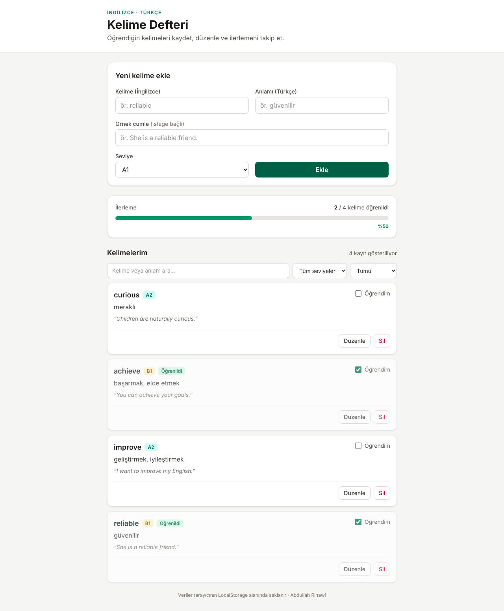
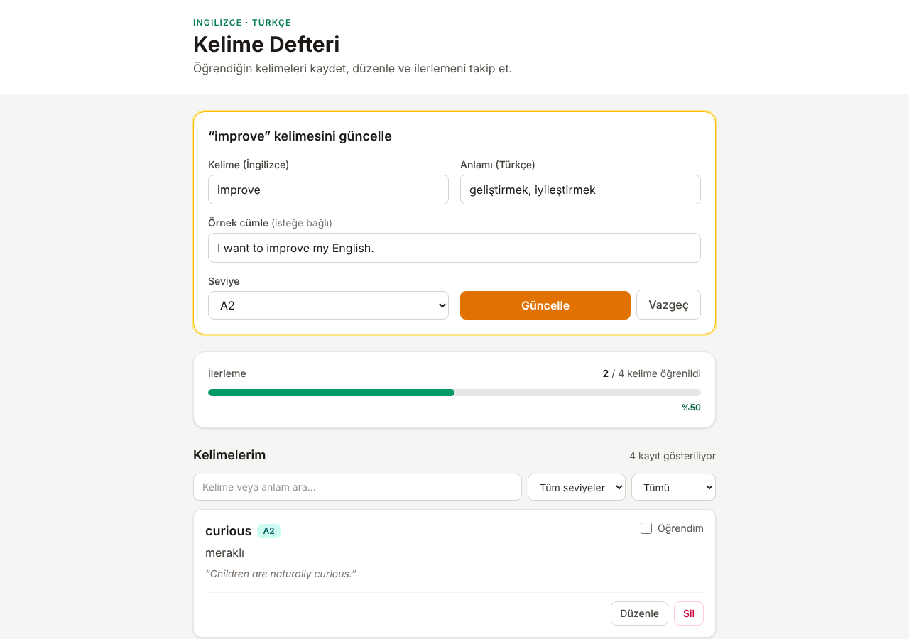
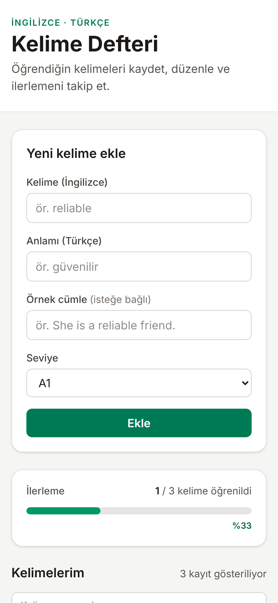

# Kelime Defteri

İngilizce kelimeleri Türkçe anlamları, örnek cümleleri ve seviyeleriyle (A1–C1) kaydeden bir React uygulaması. Veriler tarayıcının **LocalStorage** alanında saklanır; sayfa yenilense de kaybolmaz.

**Canlı demo:** _(Netlify linkini buraya ekle)_



## Özellikler

| İşlem | Nasıl yapılır |
|---|---|
| **Ekle** | Üstteki formu doldur → **Ekle**. Kelime listenin en üstüne gelir. |
| **Listele** | Tüm kelimeler en yeniden eskiye sıralanır. Kelime/anlam araması, seviye ve durum (öğreniliyor / öğrenildi) filtresi vardır. |
| **Güncelle** | Karttaki **Düzenle** → form sarıya döner, değiştir → **Güncelle**. Ayrıca **Öğrendim** kutusu kelimenin durumunu günceller. |
| **Sil** | Karttaki **Sil** → **Evet, sil** ile onayla. |

İlerleme çubuğu, öğrenilen kelimelerin toplam kelimelere oranını gösterir.

## Kullanılan teknolojiler

- React 19 + TypeScript
- Vite (kurulum ve derleme)
- Tailwind CSS 4
- LocalStorage (`useLocalStorage` hook'u)
- Netlify (yayın)

## Klasör yapısı

```
src/
├── components/        # Tekrar kullanılan arayüz parçaları
│   ├── FilterBar.tsx      # Arama + seviye + durum filtresi
│   ├── LevelBadge.tsx     # A1–C1 renkli etiket
│   ├── StatsBar.tsx       # İlerleme çubuğu
│   ├── WordCard.tsx       # Tek kelime kartı (düzenle / sil / öğrendim)
│   └── WordForm.tsx       # Ekle ve güncelle formu
├── pages/
│   └── HomePage.tsx       # Ana sayfa: CRUD mantığı burada
├── interfaces/
│   └── Word.ts            # Word, WordInput, Level tipleri
├── hooks/
│   └── useLocalStorage.ts # State'i LocalStorage'a yazan hook
├── App.tsx
├── main.tsx
└── index.css              # Tailwind içe aktarımı
```

## Bilgisayarında çalıştırma

Node.js 20 veya üstü gerekir.

```bash
npm install
npm run dev
```

Tarayıcıda `http://localhost:5173` adresini aç.

Yayın için derleme: `npm run build` (çıktı `dist/` klasörüne yazılır).

## Ekran görüntüleri

| Güncelleme modu | Mobil |
|---|---|
|  |  |

---

Abdullah Rihawi · Web Geliştirme ve Yapay Zeka eğitim projesi
